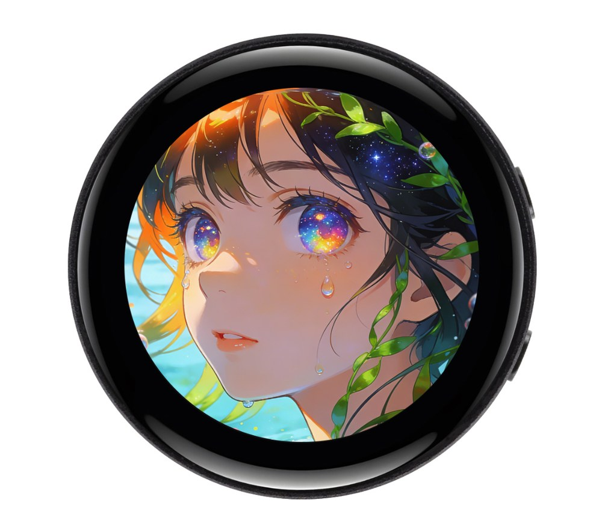

  <h1>ESP32-S3-Touch-AMOLED-1.43C</h1>
  
<strong>ESP32-S3 1.43 英寸 466 × 466 圆形触控 AMOLED 开发板</strong>

  
<a href="README.md">English</a> | <strong>简体中文</strong>

  

    
    
    
  

  
<a href="https://www.waveshare.net/shop/ESP32-S3-Touch-AMOLED-1.43C.htm">🌐 产品</a> &middot; <a href="firmware/">📦 固件</a> &middot; <a href="examples/esp-idf/">🧩 ESP-IDF</a> &middot; <a href="examples/arduino/examples/">🔧 Arduino</a> &middot; <a href="hardware/">📚 资料</a>

  

---

## ✨ 概述

本开发板集成圆形 AMOLED 电容触摸屏、扬声器音频输出和双麦克风输入，适用于交互界面与语音应用。仓库提供基础 ESP-IDF、Arduino 示例，以及新版出厂桌面的完整源码和实测合并固件。

| 项目 | 器件 / 接口 |
| --- | --- |
| 主控 | ESP32-S3-PICO-1-N8R8，双核，最高 240 MHz |
| 存储 | 8 MB Flash，8 MB 八线 PSRAM |
| 屏幕 | 1.43 英寸，466 × 466，CO5300，QSPI |
| 触摸 | CST820，电容触摸，I2C |
| 音频 | ES8311 扬声器输出，ES7210 双麦克风输入 |
| 无线 | 2.4 GHz Wi-Fi、Bluetooth LE |

## 📦 快速开始

1. 打开[固件目录](firmware/README_ZH.md)，下载日期最新、文件名包含 `FactoryOnly` 的 BIN。
2. 使用可传输数据的 USB 线连接开发板。
3. 按固件目录中的说明，选择 ESP32-S3，将合并 BIN 从 `0x0` 地址烧录。
4. 复位后进入桌面，通过设置中的配网页面连接自己的 2.4 GHz Wi-Fi。

新版桌面包含 Display Test、设置、小智、触摸测试、天气、音乐、2048、Mic Test 和按键测试。[出厂源码使用说明](examples/factory/README_ZH.md)提供操作和编译步骤。

## 🧪 示例

### ESP-IDF

| 示例 | 功能 |
| --- | --- |
| [01_ADC_Test](examples/esp-idf/01_ADC_Test/README_ZH.md) | 串口输出电池电压与充电状态 |
| [02_WIFI_AP](examples/esp-idf/02_WIFI_AP/README_ZH.md) | 建立 2.4 GHz Wi-Fi 热点 |
| [03_WIFI_STA](examples/esp-idf/03_WIFI_STA/README_ZH.md) | 连接 2.4 GHz Wi-Fi 网络 |
| [04_Audio_Test](examples/esp-idf/04_Audio_Test/README_ZH.md) | 通过 BOOT 按键录音、回放及播放内置音乐 |
| [05_LVGL_V8_Test](examples/esp-idf/05_LVGL_V8_Test/README_ZH.md) | LVGL 8 控件演示与自动亮度循环 |
| [06_LVGL_V9_Test](examples/esp-idf/06_LVGL_V9_Test/README_ZH.md) | LVGL 9 控件演示与自动亮度循环 |

### Arduino

| 示例 | 功能 |
| --- | --- |
| [01_ADC_Test](examples/arduino/examples/01_ADC_Test/README_ZH.md) | 串口输出电池电压与充电状态 |
| [02_WIFI_AP](examples/arduino/examples/02_WIFI_AP/README_ZH.md) | 建立 2.4 GHz Wi-Fi 热点 |
| [03_WIFI_STA](examples/arduino/examples/03_WIFI_STA/README_ZH.md) | 连接 2.4 GHz Wi-Fi 网络 |
| [04_Audio_Test](examples/arduino/examples/04_Audio_Test/README_ZH.md) | 通过 BOOT 按键录音、回放及播放内置音乐 |
| [05_LVGL_Widgets](examples/arduino/examples/05_LVGL_Widgets/README_ZH.md) | LVGL 9 控件演示与自动亮度循环 |
| [06_LVGL_V9_Test](examples/arduino/examples/06_LVGL_V9_Test/README_ZH.md) | LVGL 9 控件演示与自动亮度循环 |

Arduino 库位于 [`examples/arduino/libraries`](examples/arduino/libraries/)。将 `lvgl/`、`lv_conf.h` 和 `OneButton/` 复制到 Arduino 草图目录的 `libraries/` 文件夹；所有 Arduino 显示示例统一使用 LVGL 9.3.0。

## 🛠️ 开发环境

| 框架 | 版本 | 示例数 |
| --- | --- | ---: |
| ESP-IDF 基础示例 | `v5.5.3` | 6 |
| Arduino-ESP32 | `3.3.0` | 6 |
| ESP-IDF 出厂源码 | `v5.5.4` | 1 |

## 📚 资料

- [原理图](hardware/schematic/)
- [结构尺寸图](hardware/mechanical/)
- [产品详情页](https://www.waveshare.net/shop/ESP32-S3-Touch-AMOLED-1.43C.htm)
- [官方 Wiki](https://docs.waveshare.net/ESP32-S3-Touch-AMOLED-1.43C/)

## 🤝 支持

- 示例或仓库问题：[提交 Issue](https://gitee.com/waveshare/ESP32-S3-Touch-AMOLED-1.43C/issues)。
- 产品使用、硬件或售后问题：[微雪技术支持](https://docs.waveshare.net/ESP32-S3-Touch-AMOLED-1.43C/Technical-Support/)。

## 📄 许可证

Apache License 2.0，详见 [LICENSE](LICENSE)。第三方组件保留各自的许可证。
